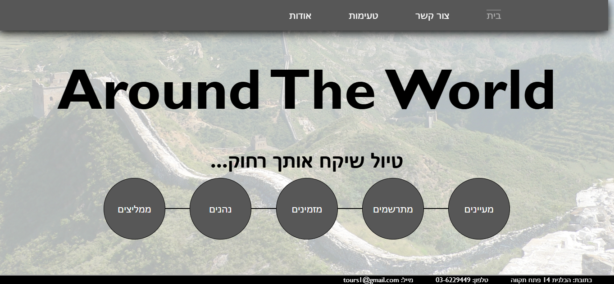
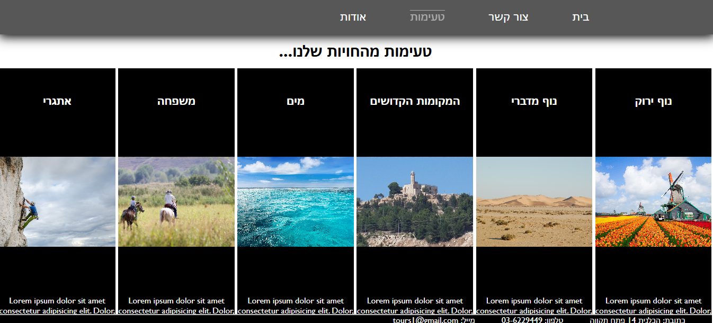

# Around The World

> 🌍 **מוכנים לצאת לדרך?**  
> אתר של סוכנות נסיעות עם קטגוריות טיולים, גלריות תמונות, מידע על הסוכנות וטופס פנייה — בנוי ב-HTML וב-CSS בלבד.

## 🖼️ הצצה לאתר

| 🏠 עמוד הבית | 📸 גלריית הטיולים |
| --- | --- |
|  |  |

## 🧭 מגלים את האתר

| עמוד | מה תמצאו בו |
| --- | --- |
| 🏠 `index/home.html` | עמוד הבית וקישורים למסע |
| 👋 `index/about.html` | מידע על הסוכנות ונתונים על טיולים |
| 📸 `index/examples.html` | קטגוריות טיולים וגלריות תמונות |
| ✉️ `index/contact.html` | טופס פנייה וטבלת דוגמאות לטיולים |

האתר כתוב בעיקר בעברית. עוברים בין העמודים באמצעות תפריט הניווט שבראש כל עמוד.

## 🎒 מה יש בתיקייה?

```text
.
├── images/          # תמונות רקע ותמונות לקטגוריות
├── index/           # עמודי האתר
└── style/           # קובצי העיצוב
```

כל עמוד HTML מקושר לקובץ CSS משלו בתיקיית `style/`. אין צורך ב-JavaScript, בהתקנת חבילות או בתהליך בנייה.

## 🚀 יוצאים לדרך

**הדרך המהירה:** פותחים את `index/home.html` בדפדפן.

**או מפעילים שרת מקומי** מתיקיית הפרויקט:

```sh
python -m http.server 8000
```

ב-Windows, אם הפקודה `python` אינה זמינה, משתמשים בפקודה `py -m http.server 8000`. לאחר מכן פותחים את <http://localhost:8000/index/home.html>.

---
✨ **בחרו יעד, דפדפו בגלריה ותנו למסע להתחיל!**
